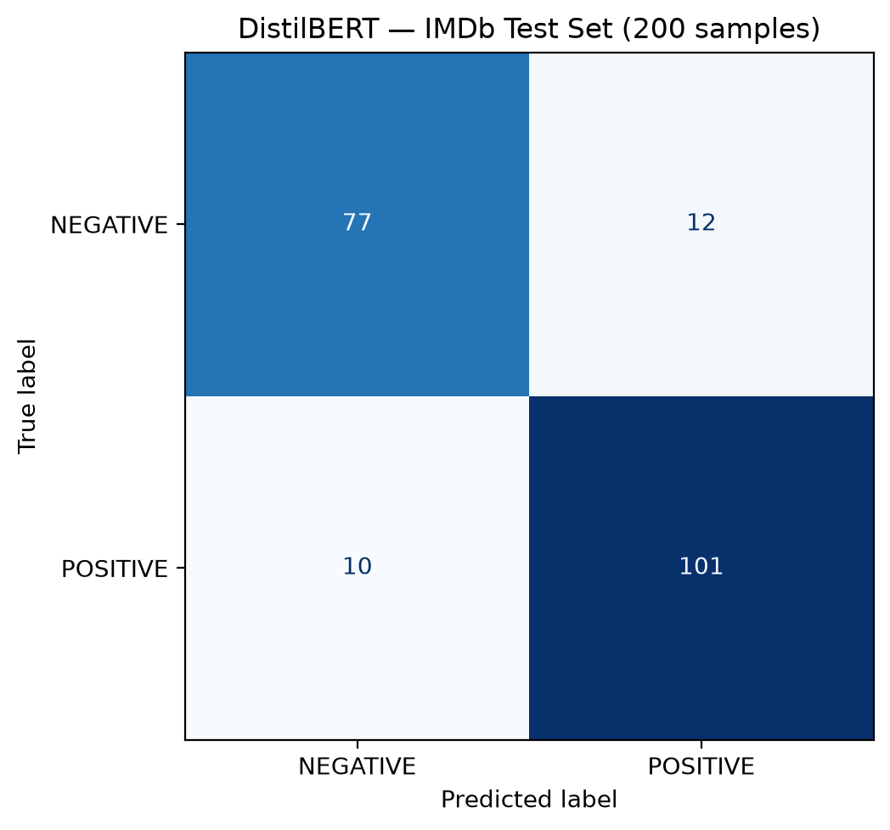

# BÁO CÁO LAB 3 – GET STARTED WITH HUGGING FACE

**Học phần:** Deep Learning  
**Nhóm thực hiện:** Nhóm 4

## 1. Mục tiêu

Lab 3 gồm hai bài thực hành. Exercise 1 tìm hiểu cách sử dụng một mô hình phân tích cảm xúc có sẵn trên Hugging Face Hub. Exercise 2 thực hành fine-tuning mô hình ngôn ngữ pretrained cho bài toán phân loại văn bản nhị phân.

Nhóm chọn DistilBERT vì đây là phiên bản rút gọn của BERT, thuận tiện để thử nghiệm với tài nguyên máy tính có hạn. Dataset IMDb gồm các nhận xét phim được gán nhãn tiêu cực (0) hoặc tích cực (1).

## 2. Exercise 1 – Sentiment Analysis

### 2.1. Cài đặt và tải mô hình

Thư viện sử dụng là `transformers` và `torch`. Nhóm sử dụng checkpoint `distilbert/distilbert-base-uncased-finetuned-sst-2-english`, đã được fine-tune cho phân tích cảm xúc.

Tokenizer và mô hình được tải bằng `AutoTokenizer.from_pretrained()` và `AutoModelForSequenceClassification.from_pretrained()`.

### 2.2. Tokenization

Câu thử nghiệm:

> I love this movie. It is amazing!

Tokenizer chuyển câu thành `input_ids` và `attention_mask`. `input_ids` là mã số của các token; `attention_mask` cho biết vị trí token cần được xử lý. Nhóm sử dụng `truncation=True` và giới hạn tối đa 512 token.

Các token đặc biệt như `[CLS]` và `[SEP]` được tokenizer bổ sung. Tensor đầu vào có dạng `(batch_size, sequence_length)`. Với một câu minh họa, `batch_size = 1`; độ dài chuỗi phụ thuộc số token sau khi xử lý.

### 2.3. Dự đoán cảm xúc

Mô hình trả về hai giá trị logits ứng với hai lớp. Hàm softmax chuyển logits thành điểm xác suất; lớp có điểm lớn hơn được chọn làm kết quả dự đoán.

Sử dụng `model.eval()` và `torch.no_grad()` để chạy dự đoán mà không cập nhật trọng số. Code được trình bày trong `notebooks/02_exercise1_sentiment.ipynb` và `src/sentiment.py`.

Điểm softmax thể hiện mức tự tin tương đối giữa hai lớp, không bảo đảm dự đoán luôn chính xác trên văn bản khác miền dữ liệu. Exercise 1 chỉ suy luận nên không tạo `Trainer` và không cập nhật trọng số.

## 3. Exercise 2 – Fine-tuning a Pretrained Model

### 3.1. Dataset

Dataset được sử dụng là `stanfordnlp/imdb`, gồm hai lớp cảm xúc. Bộ dữ liệu có 25.000 mẫu train gốc và 25.000 mẫu test gốc.

Với cấu hình thử nghiệm trên CPU, nhóm sử dụng 1.000 mẫu train, 200 mẫu validation và 200 mẫu test. Train và validation được lấy từ hai phần riêng biệt của tập train gốc; test được lấy từ split test.

Train và validation được tạo bằng `train_test_split` trên tập train gốc với `seed=42`, có phân tầng theo nhãn. Sau đó, tập con được lấy cân bằng để mỗi lớp có 500 mẫu train và 100 mẫu validation. Dữ liệu test không được dùng trong bước chọn checkpoint.

| Tập dữ liệu | Số mẫu | Mục đích |
|---|---:|---|
| Train | 1.000 | Cập nhật trọng số mô hình |
| Validation | 200 | Theo dõi loss và chọn checkpoint |
| Test | 200 | Đánh giá sau khi kết thúc huấn luyện |

### 3.2. EDA và PCA

Trước khi huấn luyện, nhóm khảo sát:

- Số lượng văn bản và tỉ lệ giữa hai nhãn.
- Độ dài văn bản tính theo số từ.
- Giá trị thiếu, văn bản rỗng và văn bản trùng.
- Phân bố văn bản trên hai thành phần chính PCA sau khi vector hóa TF-IDF.

Các bước được lập trình trong `notebooks/01_eda_pca.ipynb`. PCA chỉ phục vụ mục đích trực quan hóa; đầu vào của DistilBERT vẫn được tạo bằng tokenizer của mô hình.

Kết quả kiểm tra dữ liệu train IMDb trên máy nhóm ghi nhận 25.000 văn bản, gồm 12.500 nhãn tiêu cực và 12.500 nhãn tích cực. Không có giá trị thiếu hoặc văn bản rỗng; có 96 dòng trùng theo nội dung (0,384%). Cần xem xét các dòng trùng và nhãn tương ứng trước khi quyết định loại bỏ, tránh làm thay đổi phân phối lớp một cách không kiểm soát.

Về PCA, văn bản trước hết được biểu diễn thành vector TF-IDF. Trên tối đa 600 mẫu được chọn từ tập train, PCA chiếu dữ liệu về hai thành phần chính để quan sát mức độ chồng lấn giữa hai nhóm nhãn. Hai trục PCA không đồng nghĩa với hai giá trị cảm xúc; đây chỉ là cách quan sát phương sai trong không gian đặc trưng. Biểu đồ và tỉ lệ phương sai giải thích cần được thu từ kết quả chạy notebook, không suy luận trước từ số liệu lớp.

### 3.3. Tiền xử lý

Văn bản được tokenize với `AutoTokenizer` và giới hạn `max_length=256`. `DataCollatorWithPadding` tự động padding đến độ dài lớn nhất của từng batch nhằm hạn chế tính toán không cần thiết.

Việc dùng `truncation=True` giảm chi phí bộ nhớ cho các review dài nhưng có thể cắt mất thông tin nằm sau 256 token. Đây là đánh đổi giữa tốc độ huấn luyện và mức độ giữ lại nội dung văn bản. Nhóm không xóa stopwords hay stemming trước khi đưa vào DistilBERT vì tokenizer và encoder pretrained đã được thiết kế để xử lý ngữ cảnh từ chuỗi token.

### 3.4. Mô hình và tham số huấn luyện

Nhóm sử dụng `distilbert/distilbert-base-uncased` và bổ sung đầu phân loại hai nhãn qua `AutoModelForSequenceClassification`.

| Tham số | Giá trị |
|---|---|
| Model | DistilBERT base uncased |
| Seed | 42 |
| Epoch | 2 |
| Batch size | 8 |
| Learning rate | 2e-5 |
| Weight decay | 0.01 |
| Max length | 256 |
| Loss | Cross-entropy cho hai lớp |

`Trainer` nhận model, dữ liệu train, validation, tokenizer, data collator và hàm tính metrics. Sau mỗi epoch, mô hình được đánh giá trên validation.

**Cross-entropy loss** được tối ưu bằng AdamW. Đối với một mẫu có nhãn thật \(y\), loss là \(-\log p_y\), trong đó \(p_y\) là xác suất softmax của lớp đúng. Backpropagation tính gradient theo loss, sau đó optimizer cập nhật trọng số. `weight_decay` được dùng để hạn chế việc trọng số tăng quá lớn.

Khi lưu checkpoint, pipeline trong `src/train.py` ưu tiên validation loss thấp nhất và khôi phục checkpoint đã chọn trước khi đánh giá test. Cách lựa chọn này cần được giữ nhất quán giữa các lần chạy. Trong notebook thực nghiệm gốc, checkpoint được chọn theo validation accuracy, do đó kết quả hai quy trình không nên ghép chung.

### 3.5. Đánh giá

Các chỉ số được dùng gồm accuracy, precision, recall, F1-score và validation loss. Chỉ số test được tính sau khi chọn checkpoint để tránh sử dụng tập test trong quá trình điều chỉnh mô hình.

| Chỉ số | Công thức | Ý nghĩa |
|---|---|---|
| Accuracy | `(TP + TN) / (TP + TN + FP + FN)` | Tỷ lệ dự đoán đúng trên toàn bộ mẫu |
| Precision (+) | `TP / (TP + FP)` | Trong các mẫu dự đoán Positive, tỷ lệ đúng |
| Recall (+) | `TP / (TP + FN)` | Trong các mẫu Positive thật, tỷ lệ tìm được |
| F1 (+) | `2 × Precision × Recall / (Precision + Recall)` | Trung bình điều hòa giữa precision và recall |

Trong bài toán này, lớp Positive được đặt là nhãn 1. Nếu dữ liệu mất cân bằng, accuracy có thể gây hiểu nhầm, vì vậy nhóm sử dụng thêm precision, recall, F1 và confusion matrix để phân tích lỗi theo lớp.

Trong lần thực nghiệm đã lưu ở notebook gốc, mô hình đạt các kết quả sau:

| Chỉ số test | Kết quả |
|---|---:|
| Số mẫu | 200 |
| Accuracy | 89.00% |
| Precision lớp POSITIVE | 89.38% |
| Recall lớp POSITIVE | 90.99% |
| F1-score lớp POSITIVE | 90.18% |

Ma trận nhầm lẫn của lần thực nghiệm này:

| Nhãn thật / Dự đoán | NEGATIVE | POSITIVE |
|---|---:|---:|
| NEGATIVE | 77 | 12 |
| POSITIVE | 10 | 101 |

Kết quả trên được lấy từ `outputs/exercise2/test_metrics.json` và `outputs/exercise2/confusion_matrix.csv` thuộc lần thực nghiệm lưu trong notebook gốc. Pipeline module tại `src/train.py` sử dụng `eval_loss` để chọn checkpoint; cần chạy pipeline này để có kết quả riêng.

Từ confusion matrix, có 12 mẫu Negative bị dự đoán nhầm thành Positive (false positive) và 10 mẫu Positive bị dự đoán nhầm thành Negative (false negative). Tổng cộng mô hình sai 22/200 mẫu. Vì số mẫu test giới hạn, nên cần tránh kết luận rằng 89% là độ chính xác ổn định cho mọi đánh giá phim.

### 3.6. Lưu kết quả và khả năng tái lập

Các module được tổ chức để tách trách nhiệm: `data.py` chuẩn bị dữ liệu, `model.py` khởi tạo tokenizer và mô hình, `train.py` điều phối vòng huấn luyện, `evaluate.py` tính chỉ số và lưu dự đoán, `visualize.py` xuất learning curves.

Sau khi chạy `python main.py`, các đầu ra chính gồm `data_summary.json`, `history.csv`, `loss_curves.png`, `test_metrics.json`, `classification_report.txt`, `confusion_matrix.csv`, `confusion_matrix.png`, `test_predictions.csv`, `run_info.json` và thư mục `best_model/`.

`run_info.json` lưu cấu hình, seed, phiên bản Python/PyTorch/Transformers và checkpoint được chọn. Những thông tin này giúp nhóm đối chiếu các lần chạy. Kết quả có thể chênh lệch giữa các máy do phần cứng, phiên bản thư viện và tính không xác định của một số phép toán.

## 4. Nhận xét

Exercise 1 giúp nhóm hiểu cách một mô hình pretrained nhận đầu vào đã tokenize và trả về nhãn cảm xúc. Với Exercise 2, việc fine-tune cho phép điều chỉnh trọng số theo dữ liệu IMDb thay vì chỉ dùng mô hình phân loại có sẵn.

Accuracy 89% của lần chạy được lưu cho thấy mô hình có khả năng phân loại phần lớn các nhận xét trong tập con thử nghiệm. Tuy nhiên, tập test chỉ gồm 200 mẫu nên chưa đủ để kết luận hiệu quả trên toàn bộ IMDb hoặc các loại văn bản khác. Thời gian huấn luyện và bộ nhớ là những hạn chế khi chạy mô hình Transformer trên CPU.

## 5. Kết luận

Lab 3 giới thiệu hai cách ứng dụng Hugging Face: sử dụng checkpoint đã fine-tune để dự đoán và fine-tuning pretrained model trên bộ dữ liệu có nhãn. Nhóm đã tổ chức các bước xử lý dữ liệu, huấn luyện và đánh giá thành các notebook và module để có thể thử nghiệm theo từng phần.

## 6. Tài liệu tham khảo

Tài liệu phân tích theo từng nội dung của nhóm:

- [Dữ liệu và tiền xử lý](sections/01_data.md)
- [Kiến trúc mô hình](sections/02_model.md)
- [Huấn luyện](sections/03_training.md)
- [Đánh giá](sections/04_evaluation.md)
- [Thử nghiệm](sections/05_experiments.md)
- [Tích hợp và kiểm tra](sections/06_integration.md)

1. [Hugging Face – Fine-tuning a pretrained model](https://huggingface.co/docs/transformers/en/training#fine-tune-a-pretrained-model).
2. [Hugging Face – Getting Started with Sentiment Analysis using Python](https://huggingface.co/blog/sentiment-analysis-python).
3. [Kaggle – Sentiment Analysis using Hugging Face](https://www.kaggle.com/code/gauravduttakiit/sentiment-analysis-using-hugging-face).
4. [Kaggle – Fine-tuning BERT for Text Classification](https://www.kaggle.com/code/neerajmohan/fine-tuning-bert-for-text-classification).
